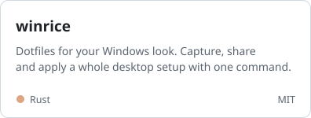
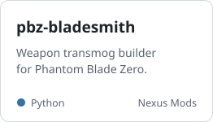

<picture>
  <source media="(prefers-color-scheme: dark)" srcset="assets/header-dark.svg">
  
</picture>

[stillwarddisplay.com](https://stillwarddisplay.com) &nbsp;·&nbsp; [Nexus Mods](https://www.nexusmods.com/profile/Ayokiru)

### Windows desktop

<a href="https://github.com/ayokiru/stillward-display"><picture><source media="(prefers-color-scheme: dark)" srcset="assets/stillward-dark.svg"></picture></a> <a href="https://github.com/ayokiru/winrice"><picture><source media="(prefers-color-scheme: dark)" srcset="assets/winrice-dark.svg"></picture></a>

### Unreal Engine modding

<a href="https://github.com/ayokiru/pakwatch"><picture><source media="(prefers-color-scheme: dark)" srcset="assets/pakwatch-dark.svg"></picture></a> <a href="https://github.com/ayokiru/modrelease"><picture><source media="(prefers-color-scheme: dark)" srcset="assets/modrelease-dark.svg"></picture></a> <a href="https://github.com/ayokiru/pbz-bladesmith"><picture><source media="(prefers-color-scheme: dark)" srcset="assets/bladesmith-dark.svg"></picture></a>
